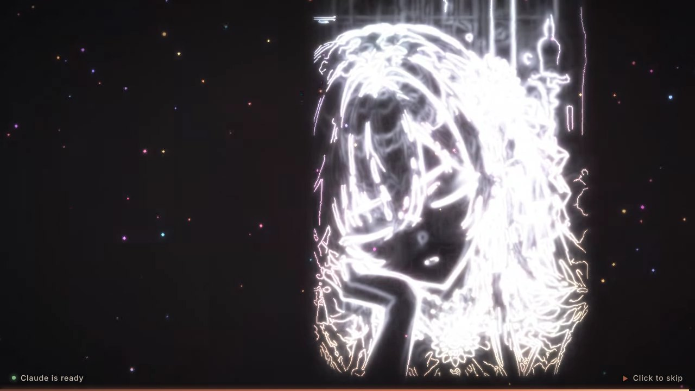

# Claude Desktop 开机动画

打开 Claude Desktop 时，先全屏放一段「Claude 大小姐」的开机动画（横版、无文字，约 9 秒）：
黑场里五彩霓虹光线勾勒出她的轮廓、光带在身边盘旋 → 线条过曝成白光 → 颜色从线条里渗出来（这时她还闭着眼）→
**缓缓睁眼**，对着口型说一句 **"Welcome back!"** → Claude 窗口就绪后淡出。点击画面 / Esc 随时跳过。


| 霓虹线稿 | 过曝 | 闭眼上色 | 睁眼（"Welcome back!"） |
| --- | --- | --- | --- |
|  |  |  |  |

思路参考 [dsh-video-skin](https://github.com/powerofjinbo/dsh-video-skin)：那边的开机动画是一段现成的
`boot.mp4`（1280×720 / 24fps / 带声音），插件只负责全屏播放、进度条、点击跳过、片尾淡出。
这里一样是「播一段视频」：`assets/boot.mp4` 是用可灵（图生视频 + 对口型）生成的，首帧的霓虹线稿和尾帧都是
这个仓库从立绘算出来的，见下文。

## 安装（macOS）

需要 [Node.js](https://nodejs.org)（LTS，或 `brew install node`）和已经装好的 Claude Desktop。
**克隆到家目录下**（别放在「桌面 / 文稿 / 下载」里：macOS 不让后台任务读这几个文件夹，watcher 会悄悄失效）：

```bash
git clone https://github.com/powerofjinbo/claude-.git ~/claude-splash
cd ~/claude-splash
bash scripts/install-mac.sh
```

它会：

1. `npm install`（下载 Electron，约 100 MB，只有第一次）
2. 找到 `/Applications/Claude.app`，写进 `config.json`
3. 建一个 `~/Applications/Claude Splash.app`：点它 = 放动画 + 同时启动 Claude（可以拖进 Dock 代替原来的 Claude 图标）
4. 装一个登录时自动运行的后台 watcher（LaunchAgent）：**不管从哪里打开 Claude**（Dock、启动台、Spotlight、`claude://` 链接……），
   只要是冷启动就放动画。不想要就加 `--no-watcher`

装完以后 **Cmd+Q 彻底退出 Claude 再打开**就能看到。卸载：`bash scripts/uninstall-mac.sh`，然后删掉这个文件夹。

不启动 Claude、只看效果：

```bash
node_modules/electron/dist/Electron.app/Contents/MacOS/Electron . --preview
```

## 安装（Windows）

需要 [Node.js](https://nodejs.org)（LTS 就行）和已经装好的 Claude Desktop。

```powershell
git clone https://github.com/powerofjinbo/claude-.git claude-splash
cd claude-splash
powershell -ExecutionPolicy Bypass -File scripts\install.ps1
```

它会：

1. `npm install`（下载 Electron，约 100 MB，只有第一次）
2. 自动找到 Claude Desktop（官网安装版 `%LOCALAPPDATA%\AnthropicClaude\claude.exe`，或 Microsoft Store / MSIX 版的应用 ID），写进 `config.json`
3. 桌面快捷方式 **Claude**（原来的会备份到 `backup\`）+ 开始菜单 **Claude Splash**：点它 = 放动画 + 同时启动 Claude
4. 一个开机自启的后台 watcher：**不管从哪里打开 Claude**（任务栏图标、开始菜单、`claude://` 链接……），只要是冷启动就放动画。
   不想要就加 `-NoWatcher`

任务栏：把旧的 Claude 图标取消固定，右键新的桌面快捷方式 → 固定到任务栏（不装 watcher 时才需要）。

卸载：`powershell -ExecutionPolicy Bypass -File scripts\uninstall.ps1`（删快捷方式和 watcher、还原备份），然后删掉这个文件夹。

不启动 Claude、只看效果：

```powershell
node_modules\electron\dist\electron.exe . --preview
```


## 它是怎么工作的

```
快捷方式 / watcher
   └─ electron .            （src/main.js）
        ├─ 无边框、透明、置顶的动画窗口（src/splash/）
        │     └─ 全屏播 assets/boot.mp4（片子里自带对好口型的 "Welcome back!"）
        └─ Windows：src/win/helper.ps1 启动 Claude、盯着 claude.exe 的主窗口出现
           macOS：open -a Claude，pgrep 看进程、src/mac/window-count.js（CGWindowList，不需要辅助功能权限）看窗口
              └─ 窗口出来 + 片子放完 → 把 Claude 叫到前台 → 动画淡出 → 退出
```

- **Claude 本来就开着**：不放动画，直接把它叫到前台。
- **片子放完 Claude 还没出来**：停在最后一帧（进度条继续走），最多等 `timing.maxWaitMs`（20 秒）。
- **找不到 Claude**：动画放完提示一下再退。
- 快捷方式和 watcher 同时触发也只会有一个动画（Electron 单实例锁）。
- 排查问题看日志：Windows `%TEMP%\claude-boot-splash.log`；macOS `$TMPDIR/claude-boot-splash.log`，watcher 的在 `/tmp/claude-splash-watcher.log`。

### 开机视频是怎么做出来的

现在的 `assets/boot.mp4`（1920×1080 / 24fps / 9 秒）是**可灵**生成的：图生视频、首尾帧模式，10 秒一镜到底，
再用可灵的「对口型」配上英文女声 "Welcome back!"。用到的首尾帧、正负提示词和设置都在
[`docs/kling/`](docs/kling/PROMPT.md)：

- 首帧 `docs/kling/a-first-lineart.png`：五彩霓虹线稿（`python tools/export_frames.py` 生成）
- 尾帧 `docs/kling/end-eyes-open.png`：抠图、深色背景上的睁眼立绘

想重新生成一版：照着 `docs/kling/PROMPT.md` 在可灵里做，下载下来覆盖 `assets/boot.mp4` 就行，启动器不用改。

#### 不用 AI 视频工具的备用方案（`tools/render_boot.py`）

不想用可灵也可以纯程序渲染一段（动作是死的，只有光效和睁眼），全部从 `assets/claude-portraits.webp`
第一行中间那张（正面上半身）算出来：

1. **放大**：Real-ESRGAN（`RealESRGAN_x4plus_anime_6B`，专门给动漫图的）4×。不装 torch：`tools/upscale.py`
   自己解 `.pth` 里的权重、用 onnx 拼出网络、onnxruntime 跑。模型第一次用时从 GitHub release 下载
2. **抠图**：GrabCut 把人物从城堡背景里抠出来放到深色底上 —— 这样描线阶段只有她的线条，背景一根都没有
3. **闭眼版**：`tools/eyes.py` 把眼睛 inpaint 成皮肤、画上渐细的眼睑线和外眼角睫毛（眼睛坐标手量）


| 阶段 | 时间 | 做法 |
| --- | --- | --- |
| 光带 | 0.2–4.2 s | 5 条参数化正弦曲线，头亮尾暗，青→紫→品红→橙→金渐变 + 多级高斯辉光 |
| 描线 | 0.9–3.9 s | 闭眼版立绘做 Canny 边缘 + 剪影外轮廓；每个连通笔画从最高点 BFS，按「沿笔画的距离」决定亮起时间，笔尖额外高亮 —— 所以是被一支光笔顺着笔画描出来，而不是整片淡入 |
| 过曝 | 3.6–5.4 s | 线条转白、辉光加大，Sobel 柔边做成「白光素描」 |
| 上色 | 4.3–6.4 s | 闭眼版立绘从冷色、低饱和渐变到正常，背景板（立绘自己的背景大幅模糊、压暗，铺满横版画面）一起亮起 |
| 睁眼 | 6.65–7.1 s | 眼睛区域里用一个纵向张开的椭圆遮罩从闭眼版切到原图 —— 像眼皮抬起来；然后眼里闪一下星芒 |
| 声音 | 全程 | numpy 合成：低频垫底、光带呼啸（扫频带通噪声）、描线电子琶音、过曝冲击、A 大调暖垫、睁眼铃音 + 混响 |
| 语音 | 7.15 s | 不在片子里：把 `config.json` 的 `voice.enabled` 打开，启动器用系统 TTS 说 "Welcome back!" |

想换一张立绘：改 `tools/render_boot.py` 顶部的 `PORTRAIT_FILE` / `PORTRAIT`（裁切框）/ `EYES_X4`（放大图里的眼睛坐标），
删掉 `tools/.cache/` 重新渲染。`assets/claude-portraits-2.webp` 是另一组备选立绘。

重新渲染（改了时间轴、换了图之类）：

```bash
pip install -r tools/requirements.txt
python tools/render_boot.py            # → assets/boot.mp4（会覆盖可灵那版），约 2 分钟
npm run render-preview                 # → docs/ 下的预览 gif 和截图（需要 playwright + ffmpeg）
```

也可以直接换成你自己的视频：`config.json` 里 `"animation": { "video": "D:/xxx/my-boot.mp4" }`。
`video` 留空（或文件坏了）会退回一套纯 CSS 的备用动画（用 `assets/claude-sheet.webp`：表情集 → 三视图 → 主视觉，带英文字）。

## 配置

复制 `config.example.json` 为 `config.json` 改需要的键就行（其余用默认值；`install.ps1` 会帮你填 `claude.target`）。常用的：

| 键 | 默认 | 说明 |
| --- | --- | --- |
| `window.mode` | `fullscreen` | `fullscreen`：铺满屏幕；`card`：屏幕中间 16:9 圆角卡片 |
| `window.scale` | `0.62` | card 模式卡片宽度占屏幕的比例 |
| `animation.speed` | `1` | `1.5` 就是快 1.5 倍（约 6 秒） |
| `animation.sound` / `volume` | `true` / `0.9` | 关掉就静音（包括片子里的 "Welcome back!"） |
| `voice.enabled` | `false` | 启动器自己再用系统 TTS 说一句；片子里已经有人声，默认关 |
| `voice.text` / `voice.atMs` | `Welcome back!` / `7150` | 打开 `voice.enabled` 时说什么、第几毫秒开口 |
| `voice.prefer` | Aria, Jenny, Zira… | 系统 TTS 嗓音偏好顺序；Windows 设置 → 时间和语言 → 语音 里可以加更多英文语音 |
| `voice.file` | `''` | 换成你自己录的 mp3/wav |
| `text.skip` | `Click to skip` | 右下角的跳过提示；留空就不显示 |
| `text.hint` / `ready` | `''` | 左下角状态（例如 `Waking Claude up…`）；默认不显示 |
| `timing.maxWaitMs` | `20000` | 片子放完后最多等 Claude 多久 |

## 开发

```bash
npm install
npm test            # 单测：配置、helper 协议、进程探测、脚本是纯 ASCII
npm run e2e         # 真起 Electron 跑 5 种情况（Linux 没显示器会自动套 xvfb-run）
npm run preview     # 本地看效果
```

CI（`.github/workflows/ci.yml`）在 Ubuntu、Windows、macOS 上都跑：

- Windows：拿 notepad.exe 冒充 Claude，走一遍真实的 PowerShell helper（启动 → 等窗口 → 叫到前台）和安装 / 卸载脚本
- macOS：拿改了名的 `caffeinate` 冒充 Claude，跑安装 / 卸载脚本，并确认后台 watcher 在它"冷启动"时真的拉起了动画

## 素材

- `assets/claude-portraits.webp`、`claude-portraits-2.webp`、`claude-sheet.webp`：Claude 大小姐立绘 / 设定图（仓库作者提供）
- `assets/boot.mp4`：仓库作者用可灵生成
- 放大模型：[Real-ESRGAN](https://github.com/xinntao/Real-ESRGAN)（BSD-3-Clause），渲染时下载，不进仓库
- 字体：Great Vibes、Cormorant Garamond（SIL OFL，见 `assets/fonts/`）
- 代码：MIT
