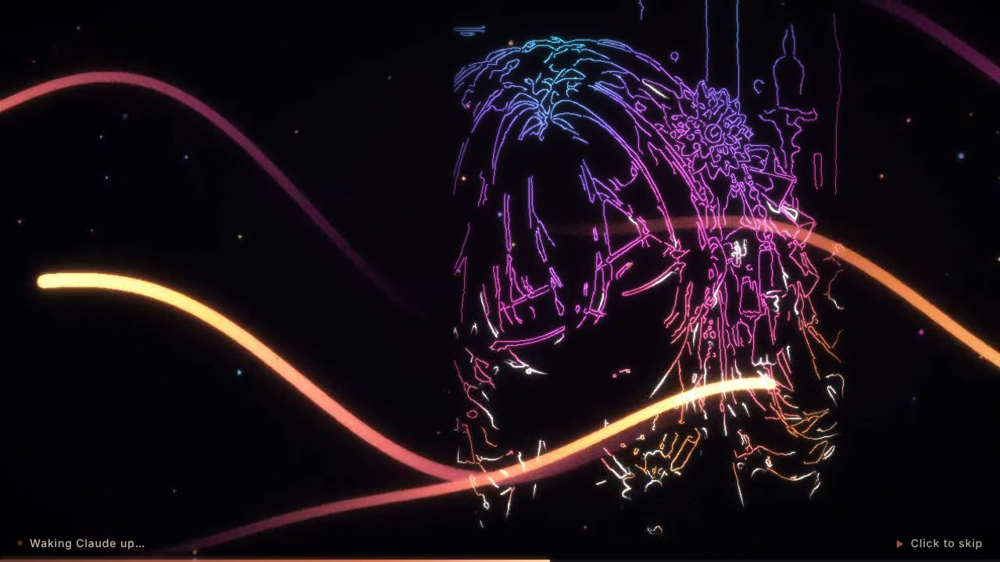

# Claude Desktop 开机动画

打开 Claude Desktop 时，先放一段「Claude 大小姐」的开机动画：
黑场里霓虹光带扫过 → 光线一笔一笔勾出她的轮廓 → 线条过曝成白光 → 颜色从线稿底下渗出来（这时她还闭着眼）→ **睁眼**，
说一句 **"Welcome back!"** → Claude 窗口就绪后淡出。点击画面 / Esc 随时跳过。


| 描线 | 过曝 | 闭眼上色 | 睁眼 · Welcome back! |
| --- | --- | --- | --- |
|  |  |  |  |

思路参考 [dsh-video-skin](https://github.com/powerofjinbo/dsh-video-skin)：那边的开机动画是一段现成的
`boot.mp4`（1280×720 / 24fps / 带声音），插件只负责全屏播放、进度条、点击跳过、片尾淡出。
这里一样是「播一段视频」，只是 **视频是从你给的那张设定图现场算出来的**（`tools/render_boot.py`），见下文。

## 安装（Windows）

需要 [Node.js](https://nodejs.org)（LTS 就行）和已经装好的 Claude Desktop。

```powershell
git clone https://github.com/powerofjinbo/claude-.git claude-splash
cd claude-splash
powershell -ExecutionPolicy Bypass -File scripts\install.ps1
```

它会：

1. `npm install`（下载 Electron，约 100 MB，只有第一次）
2. 自动找到 Claude Desktop（官网安装版 `%LOCALAPPDATA%\AnthropicClaude\claude.exe`，或 Microsoft Store / MSIX 版的应用 ID），写进 `config.json`
3. 桌面快捷方式 **Claude**（原来的会备份到 `backup\`）+ 开始菜单 **Claude Splash**：点它 = 放动画 + 同时启动 Claude
4. 一个开机自启的后台 watcher：**不管从哪里打开 Claude**（任务栏图标、开始菜单、`claude://` 链接……），只要是冷启动就放动画。
   不想要就加 `-NoWatcher`

任务栏：把旧的 Claude 图标取消固定，右键新的桌面快捷方式 → 固定到任务栏（不装 watcher 时才需要）。

卸载：`powershell -ExecutionPolicy Bypass -File scripts\uninstall.ps1`（删快捷方式和 watcher、还原备份），然后删掉这个文件夹。

不启动 Claude、只看效果：

```powershell
node_modules\electron\dist\electron.exe . --preview
```

macOS：`npm install && npx electron .` 能用（`open -a Claude` + 看进程），但没有安装脚本，算尽力而为。

## 它是怎么工作的

```
快捷方式 / watcher
   └─ electron .            （src/main.js）
        ├─ 无边框、透明、置顶的动画窗口（src/splash/）
        │     └─ 播 assets/boot.mp4 + HTML 文字层 + 系统 TTS 说 "Welcome back!"
        └─ src/win/helper.ps1：启动 Claude、盯着 claude.exe 的主窗口出现
              └─ 窗口出来 + 片子放完 → 把 Claude 叫到前台 → 动画淡出 → 退出
```

- **Claude 本来就开着**：不放动画，直接把它叫到前台。
- **片子放完 Claude 还没出来**：停在最后一帧（进度条继续走），最多等 `timing.maxWaitMs`（20 秒）。
- **找不到 Claude**：动画放完提示一下再退。
- 快捷方式和 watcher 同时触发也只会有一个动画（Electron 单实例锁）。
- 排查问题看 `%TEMP%\claude-boot-splash.log`。

### 开机视频是怎么做出来的（`tools/render_boot.py`）

全部从 `assets/claude-sheet.webp` 这一张设定图算出来，不需要任何 AI 视频工具：

| 阶段 | 时间 | 做法 |
| --- | --- | --- |
| 光带 | 0.2–4.2 s | 5 条参数化正弦曲线，头亮尾暗，青→紫→品红→橙→金渐变 + 多级高斯辉光 |
| 描线 | 0.9–3.9 s | 闭眼版立绘做 Canny 边缘；每个连通笔画从最高点 BFS，按「沿笔画的距离」决定亮起时间，笔尖额外高亮 —— 所以是被一支光笔顺着笔画描出来，而不是整片淡入 |
| 过曝 | 3.6–5.4 s | 线条转白、辉光加大，Sobel 柔边做成「白光素描」 |
| 上色 | 4.3–6.4 s | 闭眼版立绘从冷色、低饱和渐变到正常，背景板（立绘大幅模糊）一起亮起 |
| 睁眼 | 6.65–7.1 s | 眼睛区域里用一个纵向张开的椭圆遮罩从闭眼版切到原图 —— 像眼皮抬起来；然后眼里闪一下星芒 |
| 声音 | 全程 | numpy 合成：低频垫底、光带呼啸（扫频带通噪声）、描线电子琶音、过曝冲击、A 大调暖垫、睁眼铃音 + 混响 |

闭眼版在 `tools/eyes.py`：把眼睛 inpaint 成皮肤，再画上渐细的眼睑线和外眼角睫毛（眼睛坐标是按这张图手量的）。

重新渲染（改了时间轴、换了图之类）：

```bash
pip install -r tools/requirements.txt
python tools/render_boot.py            # → assets/boot.mp4，约 1~2 分钟
npm run render-preview                 # → docs/ 下的预览 gif 和截图（需要 playwright + ffmpeg）
```

也可以直接换成你自己的视频：`config.json` 里 `"animation": { "video": "D:/xxx/my-boot.mp4" }`。
`video` 留空（或文件坏了）会退回一套纯 CSS 的备用动画（表情集 → 三视图 → 主视觉）。

## 配置

复制 `config.example.json` 为 `config.json` 改需要的键就行（其余用默认值；`install.ps1` 会帮你填 `claude.target`）。常用的：

| 键 | 默认 | 说明 |
| --- | --- | --- |
| `window.mode` | `card` | `card`：屏幕中间 16:9 圆角卡片；`fullscreen`：铺满屏幕 |
| `window.scale` | `0.62` | card 模式卡片宽度占屏幕的比例 |
| `animation.speed` | `1` | `1.5` 就是快 1.5 倍（约 6 秒） |
| `animation.sound` / `volume` | `true` / `0.55` | 关掉就静音（包括说话） |
| `voice.text` | `Welcome back!` | 说的那句话（屏幕上的台词是 `text.quote`） |
| `voice.atMs` | `7150` | 第几毫秒开口（默认是刚睁眼那一下） |
| `voice.prefer` | Aria, Jenny, Zira… | 系统 TTS 嗓音偏好顺序；Windows 设置 → 时间和语言 → 语音 里可以加更多英文语音 |
| `voice.file` | `''` | 换成你自己录的 mp3/wav |
| `text.*` | 英文 | 画面上的所有文字 |
| `timing.maxWaitMs` | `20000` | 片子放完后最多等 Claude 多久 |

## 开发

```bash
npm install
npm test            # 单测：配置、helper 协议、进程探测、脚本是纯 ASCII
npm run e2e         # 真起 Electron 跑 5 种情况（Linux 没显示器会自动套 xvfb-run）
npm run preview     # 本地看效果
```

CI（`.github/workflows/ci.yml`）在 Ubuntu 和 Windows 上都跑：Windows 上拿 notepad.exe 冒充 Claude，
走一遍真实的 PowerShell helper（启动 → 等窗口 → 叫到前台）和安装 / 卸载脚本。

## 素材

- `assets/claude-sheet.webp`：Claude 大小姐设定图（仓库作者提供）
- 字体：Great Vibes、Cormorant Garamond（SIL OFL，见 `assets/fonts/`）
- 代码：MIT
